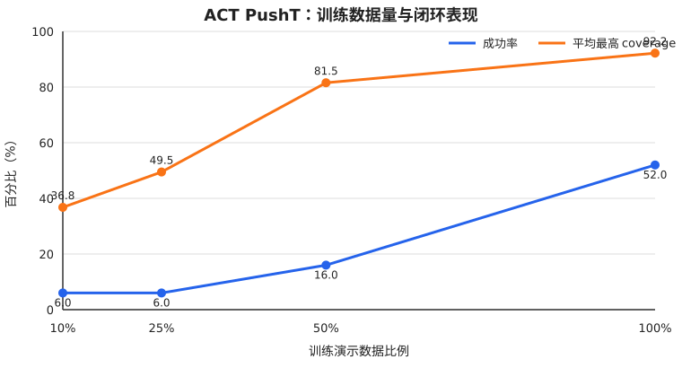

# ACT PushT 数据规模实验

一页结论与简历表述见 [实验报告](REPORT.md)。

## 研究问题

在模型结构、训练更新次数和测试场景保持不变时，给 ACT 提供更多不同的演示轨迹，是否能改善 PushT 闭环表现？

本实验只改变**训练演示数据量**。206 条演示 episode 先按固定随机种子打乱，再取嵌套前缀：10% 组包含在 25% 组中，25% 包含在 50% 中。这样较大组是在较小组的基础上增加演示，避免四组各自抽到难度不同的数据。



## 实验设计

| 项目 | 固定设置 |
|---|---|
| 模型 | LeRobot ACT，ResNet18 + CVAE + Transformer |
| 训练 | 200,000 次参数更新，batch size 8，训练 seed 1000 |
| ACT | chunk size 100，7 层 decoder，KL 权重 10 |
| 评估 | `n_action_steps=20`，50 个场景，seed 1000–1049 |
| 成功标准 | T 块与目标区域 coverage 超过 0.95 |

固定 200K 步意味着小数据组会更多次重复看到同一批演示。因此本实验回答的是：**训练计算量相同时，演示的多样性增加是否改善闭环表现**。它不回答“每条数据只训练相同轮数”时会怎样。

## 第一轮结果（每组一个训练 seed）

| 数据比例 | Episode | 实际帧数 | 成功率 | Wilson 95% CI | 平均最高 coverage | 50 并行环境完整评估耗时 |
|---:|---:|---:|---:|---:|---:|---:|
| 10% | 21 | 2,690 | 3/50 = **6%** | [2.06%, 16.22%] | 0.3679 | 34.52 s |
| 25% | 52 | 6,582 | 3/50 = **6%** | [2.06%, 16.22%] | 0.4947 | 35.39 s |
| 50% | 103 | 13,034 | 8/50 = **16%** | [8.34%, 28.51%] | 0.8154 | 35.18 s |
| 100% | 206 | 25,650 | 26/50 = **52%** | [38.51%, 65.20%] | 0.9218 | 36.10 s |

### 50% 数据的第二个训练 seed

为估计训练随机性，使用完全相同的 103 条 episode、200K 步和评估场景，仅将训练 seed 从 1000 改为 2000。seed 2000 得到 **15/50 = 30%**，平均最高 coverage **0.7852**；seed 1000 为 **8/50 = 16%**、0.8154。两次结果说明单个 seed 的 16% 不能当作 50% 数据量的稳定总体性能，正式结论应报告多个 seed 的均值和离散程度。

全量组也补了第二个 seed：seed 2000 得到 **19/50 = 38%**，平均最高 coverage **0.8069**；seed 1000 为 **26/50 = 52%**、0.9218。当前多 seed 摘要如下：

| 数据比例 | seed 成功率 | 均值 ± seed 间样本标准差 | 平均最高 coverage（均值 ± 标准差） |
|---:|---:|---:|---:|
| 50% | 16%、30% | **23.0% ± 9.9 个百分点** | 0.8003 ± 0.0214 |
| 100% | 52%、38% | **45.0% ± 9.9 个百分点** | 0.8644 ± 0.0812 |

目前全量数据组的两个 seed 平均成功率比 50% 组高 22 个百分点，但每组只有两个训练 seed，且 seed 间波动不小。因此这是支持“全量数据可能更好”的证据，还不足以作为精确的总体效应估计；不要把 22 个百分点写成确定的性能增益。

RTX 5060 Laptop GPU 上，batch=1 预测一个 100 步动作块的纯模型前向延迟为：平均 **6.705 ms**、中位数 **6.351 ms**、P95 **8.434 ms**（30 次预热、200 次计时）。该数字不包含图像预处理、仿真和视频写入。

## 如何理解结果

1. **10% 与 25% 的成功率都是 6%，不代表模型没有改善。** 25% 的平均最高 coverage 从 0.3679 上升到 0.4947，说明它通常能把 T 块推得更接近目标，但跨过 0.95 成功门槛的场景数仍是 3 个。
2. **50% 组出现明显的中间水平。** 平均最高 coverage 达到 0.8154，成功率达到 16%，但距离全量组的 52% 仍然较远。
3. **当前观察支持“更多不同演示有帮助”。** 两个指标总体随数据量增加而上升；成功率的提升呈非线性，在 50% 到 100% 之间最明显。
4. **这还是初步结论。** 每个数据量只有一次独立训练。Wilson 区间只估计这 50 个测试初始场景造成的不确定性，没有包含模型初始化、数据 shuffle 和 dropout 带来的训练随机性。

因为四组面对相同的 50 个初始场景，还可以做配对比较。全量模型相对 10%、25%、50% 模型的精确 McNemar 检验 p 值分别为 `0.000006`、`0.000002`、`0.000534`。这说明这些已训练 checkpoint 在本批固定场景上的差异清楚；它仍不能代替多个训练 seed 来证明对所有训练运行都成立。

## 可复现文件

| 文件 | 用途 |
|---|---|
| `episode_split.json` | 四组固定、嵌套的 episode ID 和实际帧数 |
| `results/raw/data_scale_*.json` | 数据规模实验的逐 episode 原始评估数据 |
| `results/raw/action_*.json`、`visual_*.json` | 动作执行长度和视觉扰动的逐 episode 原始评估数据 |
| `results/inference_latency.json` | ACT 单次动作块前向的计时结果 |
| `../../../metrics/raw/eval_C_nas20.json` | 100% 数据量的既有基线原始数据 |
| `build_results.py` | 从原始结果复算成功率、置信区间、配对检验、CSV 和图表 |
| `results.json` | 完整机器可读结果，含逐场景成功标记和 50%/seed 2000 复现实验 |
| `results.csv` | 简洁结果表 |
| `benchmark_inference.py` | ACT 动作块前向延迟测试脚本 |
| `inference_latency.json` | 推理延迟原始汇总 |
| `run_train.py` | 按固定 episode 清单启动任一数据规模的训练 |
| `run_eval.py` | 用统一的 50 场景协议评估任一 checkpoint |

重新生成汇总：

```bash
python3 learning/experiments/act_data_scale/build_results.py
```

重新测试推理延迟（在装有与本实验相同 LeRobot/PyTorch 环境的终端运行，并把 checkpoint 路径改成你的实际位置）：

```bash
python \
  learning/experiments/act_data_scale/benchmark_inference.py \
  outputs/train/act_pusht_std/checkpoints/200000/pretrained_model
```

为避免把本机路径发布到网上，公开原始 JSON 保留每个 episode 的 reward、coverage 和成功标记，但去掉运行时视频路径；代表性 GIF 单独放在 `media/`，可直接在 GitHub 页面预览。

## 项目当前阶段与下一步

项目现在已经完成三类受控实验：数据规模、动作重规划间隔和视觉鲁棒性；50% 与 100% 数据量各有两个训练 seed。扩展评估统一采用确定性 CUDA 设置，并提供固定场景的失败视频与配对场景统计。旧的主结果（20 步 52%）和确定性扩展评估（20 步 38%）使用不同评估后端设置，报告中已明确分开。作为简历项目，目前还应补第三训练 seed 和更多视觉扰动随机种子，量化训练与扰动随机性的影响；现有数字适合作为阶段性结果，不应包装成完整统计结论。

## 扩展实验：动作执行长度

固定同一个 100%/seed 1000 ACT checkpoint、同一批 50 个场景，只改变每次预测后连续执行多少步（`n_action_steps`）。训练时的 `chunk_size=100` 不变，因此这里只研究**重规划频率**，不混入动作块训练长度变化。为排除前几轮评估中的 GPU 数值差异，这一组与视觉实验统一使用确定性 PyTorch/CUDA 设置。

| `n_action_steps` | 成功率 | 平均最高 coverage | 50 场景评估耗时 |
|---:|---:|---:|---:|
| 1 | 0/50 = **0%** | 0.1932 | 53.22 s |
| 5 | 10/50 = **20%** | 0.6026 | 32.54 s |
| 10 | 24/50 = **48%** | 0.8040 | 30.66 s |
| 20 | 19/50 = **38%** | **0.9048** | 30.60 s |

从 1 步增加到 5–20 步，表现整体改善，支持“每一步都重规划会损害该策略表现”。但 10 步的硬成功率最高，20 步的平均最高 coverage 最高；配对 McNemar 检验中，10 步与 20 步差异不显著（p=0.405），所以不能据此选出唯一最优执行长度。评估耗时也显示 1 步重规划明显更慢。

确定性复测与仓库较早的官方评估基线（20 步 52%）不一致：确定性设置下 20 步为 38%。因此本节 `1/5/10/20` 数字只在确定性复测协议内比较，不应与前面的数据规模实验或旧主结果跨协议直接比较。脚本已关闭 cuDNN benchmark、TF32，并启用确定性算法；连续两次干净复测逐 episode 完全一致。

## 扩展实验：视觉扰动

扰动只加在送入策略的 RGB 图像上，位于 `[0,1]` 图像转换之后、ACT 保存的均值/标准差归一化之前；物理仿真和环境真实渲染不变。以下条件使用同一 checkpoint、50 个环境 seed（1000–1049）、`n_action_steps=20` 和同一评估器。遮挡强度按遮挡像素占整张图像的面积比例计算。

| 测试图像 | 扰动强度 | 成功率 | 平均最高 coverage |
|---|---:|---:|---:|
| 干净图像 | - | 19/50 = **38%** | 0.9048 |
| 亮度乘 0.7 | 中等 | 21/50 = **42%** | 0.8599 |
| 高斯噪声 | `sigma=0.1` | 3/50 = **6%** | 0.7216 |
| 随机黑色遮挡 | 画面面积 20% | 0/50 = **0%** | 0.2931 |

干净与亮度条件的配对比较没有显示差异（精确 McNemar p=0.824）。高斯噪声相对干净输入显著降低这批固定场景上的成功数（18 个只在干净条件成功、2 个只在噪声条件成功，p=0.00040）；20% 面积遮挡下 19 个原本干净成功的场景全部失败（p=0.0000038）。这些显著性只针对当前 checkpoint 和这 50 个配对场景，不包含训练 seed 的不确定性。

同一场景的三个 rollout 视频可直观看到退化：seed 1002 在干净图像下 coverage=1.000，在噪声下为 0.933，在 20% 遮挡下为 0.126。

- [seed 1002：干净输入，成功](media/seed1002_clean.gif)
- [seed 1002：高斯噪声，未成功](media/seed1002_noise.gif)
- [seed 1002：20% 面积遮挡，失败](media/seed1002_occlusion.gif)

所有正式比较结果及配对统计见 `extended_results.json`；逐 episode 原始数据集中在 `results/raw/`，重算表格可运行 `build_extended_results.py`。评估器是 `eval_visual_perturbation.py`。该评估器默认使用 CUDA 确定性算法，可用 `--render-episodes 2` 保存视频。

例如，重跑 20% 面积遮挡并保存前两个场景的视频：

```bash
python \
  learning/experiments/act_data_scale/eval_visual_perturbation.py \
  outputs/train/act_pusht_std/checkpoints/200000/pretrained_model \
  learning/experiments/act_data_scale/visual_rerun_occlusion \
  --corruption occlusion --severity 0.2 --seed 1000 \
  --corruption-seed 22003 --n-action-steps 20 \
  --n-episodes 50 --render-episodes 2
```
